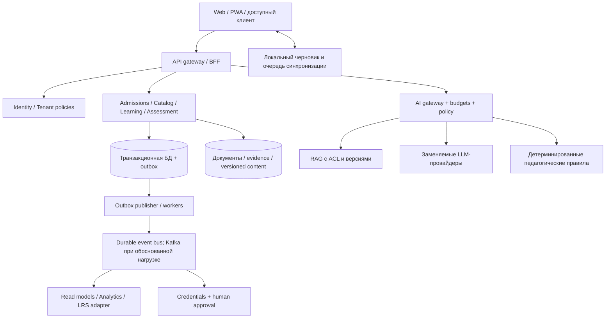

# 03. Целевая архитектура и журнал решений (ADR)

Срез 19.11.2026. Все размеры, бюджеты latency и эксплуатационные пороги — **проектные цели D01–D18**, не проверенные свойства нынешнего сайта. Предположения об эффекте технологий — **[HYPOTHESIS H18–H24]**. ADR (architecture decision record) фиксирует решение, альтернативу, цену, отказ и критерий пересмотра.

## 1. Граница системы и честный ответ на инварианты

Исходное состояние: `academy/app.js` хранит настройки, заявки, сообщения и оценки в localStorage; роль выбирается пользователем. Это не multi-tenant backend и не безопасная offline-архитектура. **[FACT: код репозитория, 19.11.2026]**. Проект D01 требует нового серверного контура; менять подпись «демо» недостаточно. Старые пароли в `auth-system.js` не мигрируются как настоящие учётные записи. Демо-сертификаты в JSON не считаются доказательствами выдачи.

Целевые bounded contexts: Identity & Tenant; Catalog & Eligibility; Admissions; Enrollment & Learning; Assessment & Evidence; Credentials; Messaging; Billing; Integration; Analytics; AI Gateway. Владелец каждого контекста отвечает за API, схему события, сроки хранения и восстановление. Учётная запись человека не равна его членству в организации: один пользователь может иметь несколько memberships с разными правами.

**Отступление от буквальной независимости всех сервисов:** для MVP внутренние доменные модули могут жить в одном deployment с запретом прямого доступа к чужим таблицам. Отдельно деплоятся gateway AI и асинхронные workers. Строгая service-oriented ecosystem достигается контрактами и последующим выделением; это не соответствие требованию независимого деплоя каждого сценария на старте. Если независимый deploy обязателен договором уже в MVP, scope сокращается до 3–4 сервисов и пересчитываются команда/on-call/стоимость.

**Событийность:** все значимые доменные переходы и необходимые учебные действия порождают события. Не каждое движение курсора, не содержимое пароля, не полный текст паспорта. Адаптация использует поток, но агрегаты обучения и финансов могут сверяться batch-процессом. Запрет любых batch не повышает корректность автоматически. **Credentials:** каждый подтверждённый assessed skill становится кандидатом в credential, а не автоматически выпускаемым бейджем после вероятностного mastery. Это сознательная защита от credential inflation.

### Что здесь может пойти не так

- Модульный backend превращается в связанную общую БД без границ и не может быть выделен позднее.
- Требование «всё событие» создаёт бесконтрольный сбор персональных данных и дорогую аналитику.
- Архитектурная диаграмма принимается за нагрузочное доказательство или уже созданный сервис.

## 2. Ключевые ADR: цена и граница каждого решения

| ADR | Решение и альтернатива | Цена | Условие отказа / пересмотра |
|---|---|---|---|
| **D01 Deployment** | Модульное транзакционное ядро → выделение сервисов; вместо немедленных 20 микросервисов | Дисциплина контрактов, миграции и contract tests; позднее временное дублирование инфраструктуры | Выделять при независимом ownership, разном масштабировании или SLO, не ради числа сервисов |
| **D08 Events** | Transactional outbox + at-least-once доставка; синхронный response для receipt; не event-sourcing всех сущностей | Outbox, retry, дедупликация, lag monitoring, DLQ | Если publisher отстал, основные записи сохраняются; сертификаты/аналитика ждут, не домысливают |
| **D09 Bus** | Управляемая очередь в MVP; Kafka при потребности в replay, partitioned streams и нескольких consumers | Эксплуатация брокера, retention, схемы, capacity, дежурство | Пересмотр при измеренном ограничении throughput/ordering; Kafka не делает внешнюю оплату exactly-once |
| **D10 AI** | RAG (retrieval-augmented generation) по одобренному корпусу + инструментальный расчёт; fine-tuning только после сравнения | Индексация, ACL-фильтры, evals, версии, review; RAG добавляет latency | Нет источника/прав доступа/согласованной версии — не генерировать предметный ответ |
| **D11 Mastery** | Простые правила и тесты → Bayesian Knowledge Tracing (BKT) для размеченных навыков | Q-matrix, калибровка slip/guess/transition, мониторинг drift | Нет достаточных попыток или задача комплексная — неопределённость, не ложная точность |
| **D12 Agents** | Ограниченный workflow; multi-agent только для offline-authoring и сложных интеграций | Дополнительные вызовы, коррелированные ошибки, сложный replay, секреты | Нет выигрыша в слепой проверке при том же бюджете — отключить агентов |
| **D13 Offline** | Версионированный пакет + локальная очередь + server receipt; не last-write-wins для оценок | IndexedDB, управление ключами, миграции, sync UX, тесты потери сети | Устройство не доверенное — без чувствительных кэшей; storage evicted — предупредить и восстановить из сервера |
| **D14 Credentials** | Подписанные W3C VC, registry issuer/status; DID опционален, blockchain не в MVP | KMS, rotation, revoke/suspend, wallet interoperability, право issuer | Нет признанного assessment или отозвано основание — не выпускать; chain не исправляет ложное утверждение |
| **D15 Integration** | Каноническая модель + отдельные LTI/xAPI/SCORM/SIS adapters | Поддержка версий и семантических отображений; sandbox и conformance | Интеграция не проходит round-trip тест — не обещать двустороннюю совместимость |
| **D16 Runtime** | Serverless для burst-worker и webhook; постоянные сервисы для синхронного пути | Cold start, лимиты исполнения, стоимость на вызов, наблюдаемость | AI p95 не укладывается — warm capacity/очередь; не ставить тяжёлую оркестрацию в request path |

Kafka документирует ограничение exactly-once для внешних систем: оно требует их участия.[^t1] Поэтому запись `ApplicationSubmitted` и outbox выполняются в одной транзакции, а consumer ведёт inbox с уникальным `event_id`. Выдача документа имеет business idempotency key. Внешняя платёжная система не вызывается повторно без её idempotency-механизма. Повторная доставка не должна удвоить результат.

Событие D08 содержит `event_id`, `event_type`, `schema_version`, `tenant_id`, псевдоним `subject_ref`, `aggregate_id`, `aggregate_version`, `occurred_at`, `received_at`, `correlation_id`, `purpose`, `policy_version`. Содержание документа хранится отдельно. Для `answer.submitted` фиксируются task version, assessment mode, hint usage и источник `offline/online`. Старый event не переинтерпретируется новой рубрикой без явного нового расчёта. Replay не должен повторно рассылать письма и выпускать credentials; consumers различают восстановление проекции и внешний side effect.

### Педагогический AI-движок

Предложенный pipeline D10: проверка доступа → минимизация запроса → retrieval по tenant/program/version → проверка достаточности источников → выбор педагогической стратегии → ограниченный ответ с цитатой → выходной контроль → событие с версиями. Для вычисления service level, safety stock или EOQ вызывается проверенная функция с явными единицами, а не свободная арифметика LLM. Источник может сам содержать prompt injection: retrieved text считается данными, не инструкцией управления.

Dynamic Model Switching System разделяется на **выбор стратегии обучения** и **маршрутизацию модели**. Это разные решения. Стратегия: неизвестны prerequisites — короткая диагностика/прямое объяснение (direct instruction); повторяющаяся процедурная ошибка — поддержка с постепенным снятием (scaffolding); достаточная база и низкая усталость по самоотчёту — сократические вопросы (Socratic questioning). Маршрутизация: классификация запроса может быть rules/small model, объяснение — approved LLM, критический расчёт — tool. Эти правила — **[HYPOTHESIS H18]**, не универсальная педагогика и не диагностическая оценка эмоций.

BKT моделирует скрытое состояние освоения с вероятностями исходного знания, перехода, угадывания и случайной ошибки; это традиция knowledge tracing, а не новое свойство LLM.[^t2] Практическая цена — качественная разметка «какой навык проверяет задача». Ответ, полученный с подсказкой, нельзя считать равным самостоятельному. Если параметры неидентифицируемы или изменился банк задач, используем простую наблюдаемую рубрику и маркировку «данных недостаточно».

**Мультипликативность [HYPOTHESIS H19]:** RAG уменьшает неподтверждённые объяснения, BKT/рубрика выбирает нужную практику, offline сохраняет непрерывность, а независимая проверка связывает это с результатом. Чтобы назвать эффект не аддитивным, нужен факторный эксперимент: для двух компонентов `I = ΔAB − ΔA − ΔB` при общем control, сопоставимых затратах и независимом тесте. Положительное I с доверительным интервалом выше нуля — свидетельство interaction, не сравнение двух красивых демо. Связка ломается при неверной skill taxonomy, устаревшем retrieval, cheating и несинхронизированных событиях.

Агенты Designer/Evaluator/Tutor/Analytics/Quality/Integrator — **роли исполнения workflow**, не шесть независимых авторитетов. Designer готовит черновик; Evaluator проверяет соответствие рубрике; Quality запускает инструментальные тесты и экспертный gate; Tutor общается в пределах approved packet; Analytics считает агрегаты, но не читает все паспорта; Integrator предлагает scoped API action. Общий LLM у Designer и Evaluator может повторить одну ошибку. Нужны независимые источники и человек, а не голосование моделей.

MCP (Model Context Protocol) — адаптер взаимодействия AI с инструментами, не замена LMS, LTI, авторизации и согласия. Привилегии короткоживущие и ограничены действием; `write_grade`, `issue_credential`, `enroll` требуют подтверждения и серверной политики. MCP security guidance запрещает token passthrough и описывает confused-deputy риски.[^t3] Производственная интеграция фиксирует конкретную версию протокола и контрактные тесты, а не предполагает совместимость со всеми будущими агентами.

### Что здесь может пойти не так

- RAG находит релевантный, но юридически недоступный корпоративный документ другой организации.
- BKT «уверен» в освоении, потому что AI решал задачи за студента.
- Quality-agent подтверждает ошибку Designer, поскольку использует те же знания и ту же модель.
- Повтор событий вызывает повторную выдачу сертификатов или списание денег.

## 3. Offline, стандарты и надёжность без магических обещаний

**D13 offline-first:** авторизованный учащийся заранее скачивает content packet с manifest, hash и approved hints. Service worker обслуживает доступные ресурсы; IndexedDB хранит попытки с UUID, task version, client sequence и base revision. Синхронизация передаёт пакет идемпотентно, сервер возвращает квитанцию для каждой попытки. Попытка append-only, редактирование анкеты — optimistic concurrency, параллельные свободные заметки могут использовать CRDT только при доказанной необходимости. Сертифицирующая оценка не сливается CRDT и не принимается только по времени устройства. Offline-задача финального экзамена может потребовать подтверждения и отдельного контролируемого окна.

Цена конфликтов не скрывается: при редактировании с двух устройств показываются обе версии и причина выбора. Нельзя гарантировать отсутствие потерь при физической потере несинхронизированного устройства или очистке браузера. Требование уточняется как отсутствие молчаливой потери **подтверждённых** сервером операций и видимое состояние неподтверждённых. Локальные ключи и WebCrypto не защищают от XSS в активной сессии; нужен отдельный threat model, ограничение скриптов и отказ от хранения особых категорий offline. Logout очищает локальные доступы, но удалённый wipe потерянного offline-устройства не гарантируется.

**Pre-computed AI:** пакет содержит человечески одобренные объяснения типовых ошибок и дерево подсказок; при недоступности модели учебная задача остаётся выполнимой. Называть этот режим live-AI нельзя. Если сеть появилась посреди ответа, интерфейс не подменяет уже данное объяснение без предупреждения. Offline-результат попадает в агрегаты только после проверки receipt и условий задания. До этого наставник видит «данные могут быть неполными».

**Интероперабельность:** xAPI описывает учебные statements, LRS (learning record store) их хранит; внутренняя очередь событий не становится conformant LRS автоматически.[^t4] Caliper служит образовательной аналитике, LTI 1.3 — безопасному запуску инструментов; LTI Advantage добавляет grade/roster/deep-linking services.[^t5] Мы выбираем каноническую внутреннюю модель и экспортные adapters, а не параллельный сбор каждого клика в пяти форматах. SCORM — legacy-import с sandbox и проверкой пакетов: его packaging/runtime/sequencing не дают автоматически модель навыков.[^t6] SIS (student information system), ERP и HRIS интегрируются через контракт владения: SIS владеет зачислением, LMS — попытками, HR — ролью сотрудника. Для каждой сущности указывается master и reconcile job.

**VC/DID:** стандарт W3C VC 2.0 не требует DID; registry может быть не blockchain.[^t7] Подпись проверяет issuer/целостность, затем verifier отдельно проверяет status, срок, право issuer и доверие рубрике. Каждая микроквалификация несёт versioned criteria, evidence reference, assessor и область применимости. Публикация персонального результата on-chain не принимается; если позже нужен независимый timestamp, сначала исследуется вариант без индивидуального коррелируемого следа. Потеря домена issuer, смена ключа и отзыв credential входят в тест, а не в FAQ после запуска.

### SLO, capacity и эксплуатационный бюджет

| Требование | Проверяемый контракт D17 | Граница/деградация |
|---|---|---|
| AI p95 ≤2,5 с | От отправки текста до полного короткого ответа до 120 токенов либо полезной детерминированной подсказки; отдельно p95 first meaningful token и p95 полного LLM-ответа | Сетевой бюджет 250 мс, auth 100, retrieval 300, generation 1400, output check 150, запас 300: сумма 2500 мс. Это бюджет, не измерение |
| Критические пути 99,9% | Серверные login/content entitlement/submission receipt, rolling 30 дней, отдельные SLIs | 43,2 мин/30 дней; offline-успех не маскирует серверную недоступность, измеряется отдельно |
| 1 млн concurrent | Нагрузочный профиль, а не число аккаунтов: 5% активных AI-запросов в минуту → 833 RPS | При 300 output tokens это около 250 тыс. output tokens/sec; объём считать до покупки инфраструктуры |
| События | Один event/15 секунд на активного → около 66,7 тыс./сек | При среднем 1 КБ около 5,76 ТБ/сутки до репликации и индексов; вводить минимизацию и retention |
| Видео | При 1 Мбит/сек × 1 млн → 1 Тбит/сек egress | CDN и география обязательны; это отдельная экономика, не стоимость API |
| Recovery | Целевые RPO ≤5 мин и RTO ≤60 мин для транзакционного контура | Для уже выданного submission receipt — durable multi-AZ commit; потеря региона и несинхронизированные черновики рассматриваются отдельно |

При трёх последовательных внешних провайдерах с независимой доступностью 99,9% общая доступность последовательного пути около `0.999^3=99.7003%`. Это арифметическая иллюстрация, не измерение независимости отказов. Поэтому LLM не стоит на критическом пути сдачи задания. P95 нельзя «обеспечить» сложением p95 компонентов: бюджет проверяется сквозными traces и нагрузкой. При AI timeout полезная подсказка может уложиться в SLO, но доля fallback и задержка полноценного AI публикуются отдельно, иначе метрика обманчива.

Горизонтальное масштабирование до миллиона — **[HYPOTHESIS H20]**, а не безусловная гарантия линейной стоимости. Предлагаются regional cells, partitioning по tenant/learner, CDN, лимиты запросов, asynchronous analytics, connection pooling. Стоимость обычно имеет ступени capacity; условие приёмки D18 — измеренный диапазон cost per active learner и cost per verified outcome на 1k/10k/100k synthetic concurrency. Переход к миллиону требует нагрузочного бюджета, квот и распределения стран. Архитектура сохраняет путь масштабирования, но не отменяет физику трафика и закупок.

### Что здесь может пойти не так

- Метрика first token объявляется метрикой полного ответа, скрывая 15 секунд ожидания.
- Offline-доступность искусственно повышает серверный SLO, хотя пользователь не может подать заявление.
- Восстановление проверено для БД, но не для ключей подписи, evidence и очереди outbox.
- Экономика миллиона learners не учитывает CDN, репликацию, квоты inference и распределённую поддержку.

[^t1]: Apache Kafka, Design / Message Delivery Semantics, документация 4.3, [1](https://kafka.apache.org/43/design/design/), дата страницы не установлена, обращение 19.11.2026.
[^t2]: Corbett & Anderson, Knowledge tracing, декабрь 1994, [1](https://link.springer.com/article/10.1007/BF01099821); обзор Knowledge Tracing: A Survey, [3](https://dl.acm.org/doi/full/10.1145/3569576), дата публикации в полученной выдержке не установлена. Обращение 19.11.2026.
[^t3]: MCP, Authorization, версия спецификации 2025-11-25, [1](https://modelcontextprotocol.io/specification/2025-11-25/basic/authorization). Обращение 19.11.2026. Это фиксированный baseline для ADR, не заявление о последней версии протокола.
[^t4]: ADL Initiative, LRS 2.0 conformance entry, [1](https://adopters.adlnet.gov/products/015e40cc-b567-4f41-b478-d09a3bd05d86/), дата публикации не установлена, обращение 19.11.2026.
[^t5]: 1EdTech, [LTI](https://www.1edtech.org/standards/lti) [1](https://www.1edtech.org/standards/lti), [Caliper connector](https://standards.1edtech.org/lti/specifications/services/caliper_connector/lti-spec-caliper), изменяемые спецификации, обращение 19.11.2026.
[^t6]: ADL, SCORM Users Guide for Programmers, 15.09.2011, [1](https://www.adlnet.gov/assets/uploads/SCORM_Users_Guide_for_Programmers.pdf). Обращение 19.11.2026.
[^t7]: W3C, VC Data Model v2.0, Recommendation 15.05.2025, [1](https://www.w3.org/TR/vc-data-model-2.0/), identifiers/ecosystem/privacy. Обращение 19.11.2026.
